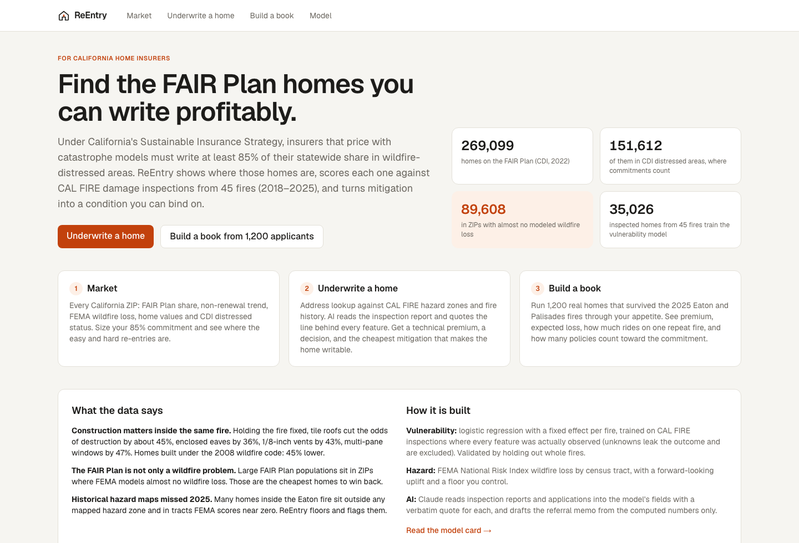
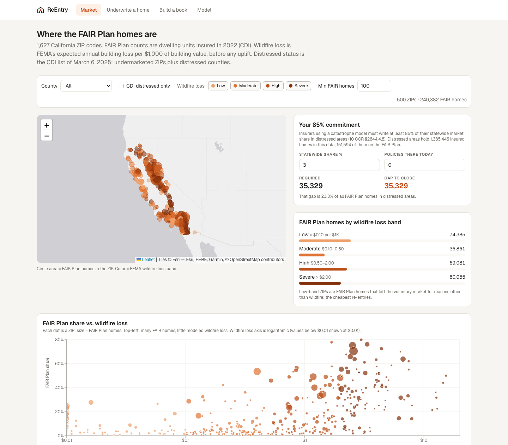
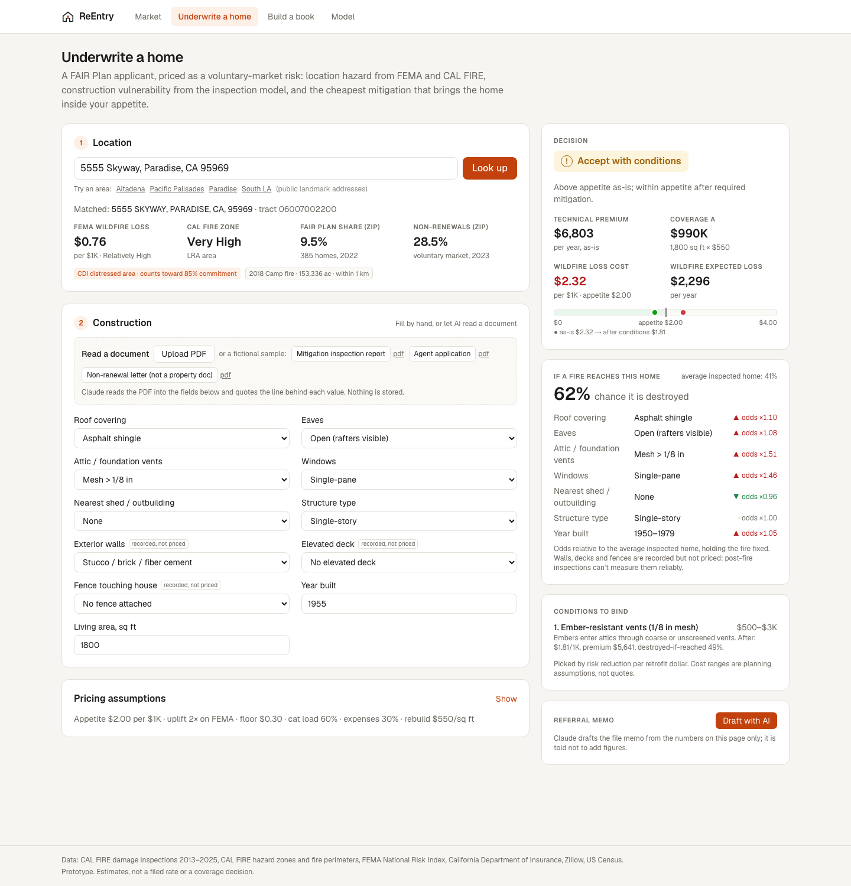
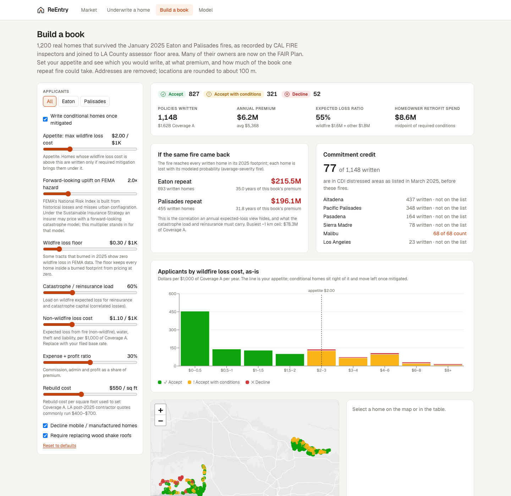
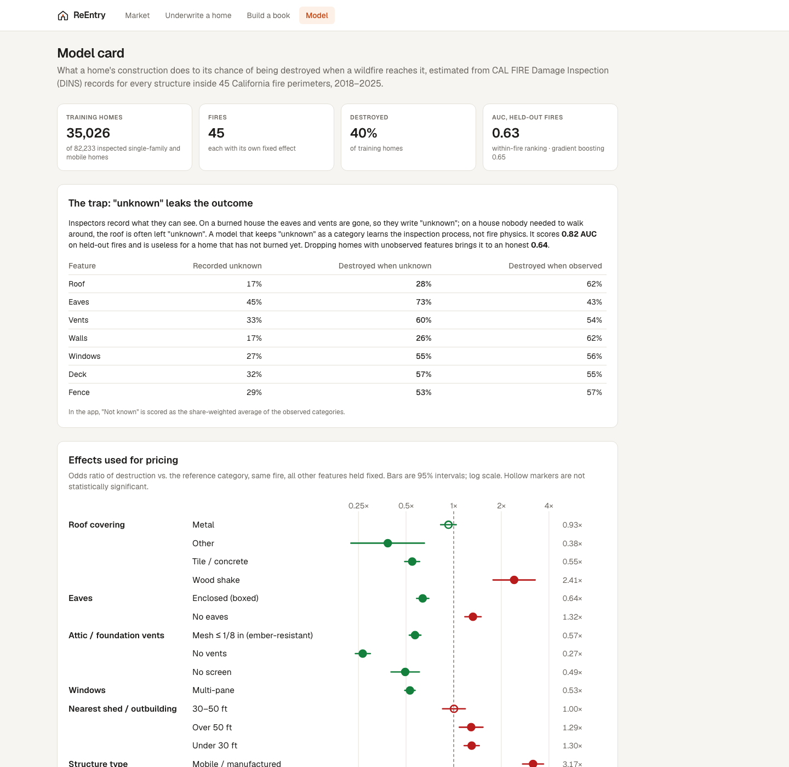
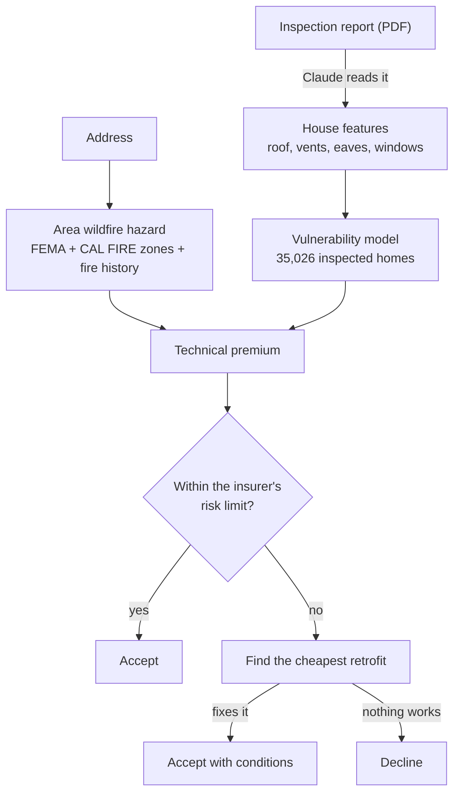

# ReEntry

**A decision tool that helps California home insurers decide which wildfire-area homes to insure again, at what price, and on what conditions.**

Built on public government data: 130,000+ CAL FIRE damage inspections, FEMA risk estimates, and California Department of Insurance market data. Inspired by the "Uninsurable" theme of the UCLA Anderson MSBA Vibathon 2026.



---

## The problem, in plain English

After years of record wildfires, many insurers stopped renewing home policies in California. Homeowners who can't find coverage end up on the **California FAIR Plan**, the state's insurer of last resort. It is expensive and covers fire only. About **269,000 homes** were on it in 2022.

In 2024–2025 California changed the rules. Insurers may now use modern catastrophe models to set prices, but only if they **write at least 85% of their statewide market share in wildfire-distressed areas**. In effect, insurers are being asked to go back into the places they left.

That leaves an insurer's underwriting team with a hard question: **which of these homes can we insure without losing money, at what price, and what must the owner fix first?**

## What ReEntry does

ReEntry answers that question for the insurer. Most tools in this space help a homeowner leave the FAIR Plan. This one sits on the other side of the table. For each home it:

1. **Measures the location's wildfire risk** from FEMA and CAL FIRE maps and the area's fire history.
2. **Measures the house itself.** A statistical model, trained on what actually happened to 35,000 homes inside 45 California fires, estimates how roof, vents, eaves, windows and other features change the chance the house is destroyed.
3. **Prices it** and gives a decision: *accept*, *accept with conditions*, or *decline*.
4. **Finds the cheapest fix.** If a home is too risky as-is, it picks the retrofits (for example, ember-resistant vents) that bring it within the insurer's risk limit for the least money. These become conditions of coverage.
5. **Uses AI to save paperwork.** Claude reads an uploaded inspection report and fills in the house details, quoting the exact line behind each answer. It also drafts the underwriter's file memo.

## A tour of the app

### 1. Market: where are the homes, and how many does the insurer need?

Every California ZIP code on one map: how many homes are on the FAIR Plan, how much wildfire loss FEMA expects there, and whether the state counts it as "distressed." Enter a market share and it calculates how many policies the 85% rule requires.



### 2. Underwrite a home: one applicant, start to finish

Type an address, or click an example. In the screenshot below, a home in Paradise, CA sits in a *Very High* hazard zone, within 1 km of the 2018 Camp Fire. As built, it would cost **$6,803/year** to insure and is over the insurer's risk limit. Replacing its attic vents with 1/8-inch ember-resistant mesh (about $500–$3,000) brings it back under the limit. The result is **accept with conditions**.



### 3. Build a book: 1,200 real homes at once

The book is the 1,200 homes that survived the January 2025 Eaton and Palisades fires (addresses removed), run through the insurer's rules. Move the sliders and watch the premium, expected profit, and exposure to a repeat fire change.



### 4. Model card: how the risk model was built, and what it can't do

This page documents the data, validation, and limits of the model, including a data-quality trap the model had to avoid (see findings below).



## Key findings

- **About 89,600 FAIR Plan homes are in ZIP codes where FEMA expects almost no wildfire loss.** These homes left the regular market for reasons other than wildfire, which makes them the cheapest to win back.
- **Construction matters, even inside the same fire.** Comparing homes in the same fire, tile roofs cut the odds of destruction by about 45%, ember-resistant vents by 43%, multi-pane windows by 47%, and building under California's 2008 wildfire code by 45%. Wood-shake roofs raise the odds 2.4×.
- **A hidden trap in the government data.** Fire inspectors often can't see the eaves or vents on a house that has already burned, so they record "unknown." A naive model learns that "unknown" means "destroyed" and looks impressive (0.82 AUC), but it is useless for a house that hasn't burned yet. Removing that leak gives an honest 0.64. ReEntry uses the honest model.
- **The old hazard maps missed 2025.** Some addresses inside the 2025 Altadena and Pacific Palisades burn areas had a FEMA expected wildfire loss of $0. ReEntry flags these and applies a minimum price.
- **The real risk is concentration, not any single home.** With default settings, the demo book insures 1,148 of 1,200 homes for $6.2M a year at a healthy 55% expected loss ratio. A repeat of the Eaton fire, though, would cost about **$216M, roughly 35 years of premium in one event**. That is why reinsurance and spreading risk across regions matter more than any one home's score.
- **The rule's map and the fire map don't line up.** The 2025 fire neighborhoods were not on the state's March 2025 "distressed" list. Of the 1,148 homes written, only 77 (in Malibu and Topanga) count toward the 85% commitment.

## Insurance terms used here

| Term | Meaning |
|---|---|
| **FAIR Plan** | California's insurer of last resort, for homes no regular insurer will cover. |
| **Underwriting** | Deciding whether to insure something, and on what terms. |
| **Appetite** | How much risk the insurer is willing to accept per home. |
| **Technical premium** | The price that covers expected losses, catastrophe costs and expenses, before any discounts or rate rules. |
| **Loss ratio** | Claims paid ÷ premium collected. Lower is better: with expenses around 30% of premium, anything under about 70% is profitable. |
| **Book** | The full set of policies an insurer has written. |
| **Coverage A** | The insured cost to rebuild the house itself. |

## How it works



**Pricing:**

- **Wildfire loss cost** = area hazard (FEMA loss rate × a forward-looking uplift, with a floor) × the home's vulnerability relative to the average home.
- **Technical premium** = (wildfire loss × (1 + catastrophe load) + non-wildfire loss) ÷ (1 − expense ratio).

Every business assumption (uplift, floor, catastrophe load, expense ratio, rebuild cost per square foot, risk limit) is a slider. An insurer can plug in its own numbers.

**The vulnerability model:**

- **Data:** CAL FIRE Damage Inspection (DINS) records, 132,522 structures. The model uses the 35,026 single-family and mobile homes, across 45 fires from 2018–2025, where all seven priced features were actually observed.
- **Method:** logistic regression with a fixed effect per fire, so that wind and fire intensity aren't credited to the house.
- **Validation:** 5-fold cross-validation that holds out entire fires. Logistic regression was kept over gradient boosting (0.63 vs 0.65 within-fire AUC) because it is interpretable and easier to file with regulators.
- **Recorded, but deliberately not priced:** exterior walls, decks and fences (a burned wood fence is usually recorded as "none") and spacing between houses (the location data is too coarse).

**Use of AI:**

- **Document reading:** Claude reads a PDF into the model's exact fields using structured output. Every value must come with a verbatim quote and page number, and anything not stated stays "unknown." Documents that aren't about a property, such as a non-renewal letter, are detected and rejected.
- **Referral memo:** Claude drafts the memo only from numbers already computed on the page, and is instructed not to introduce new figures.
- **Privacy:** no uploaded file is stored.

## Skills this project demonstrates

| Area | What was done |
|---|---|
| **Problem framing** | Picked an underserved user (the insurer, not the homeowner) and tied the tool to a real regulatory deadline. |
| **Data engineering** | Pulled and joined 9 public sources (ArcGIS REST services, PDFs, CSVs). Built geospatial joins from address to census tract, ZIP, hazard zone and fire perimeter. |
| **Statistical modeling** | Fixed-effects logistic regression with confidence intervals, grouped cross-validation, calibration, and a feature-by-feature check for target leakage. |
| **Insurance analytics** | Technical pricing, risk appetite, mitigation ranked by cost-effectiveness, portfolio concentration (probable maximum loss), and regulatory commitment tracking. |
| **Applied AI** | LLM document extraction with schema validation and quote-grounding, plus guarded memo generation. |
| **Product & front end** | An interactive web app with maps, charts and live recalculation, designed for a non-technical business user. |

**Built with:** Python (pandas, GeoPandas, statsmodels, scikit-learn), TypeScript, Next.js, React, Tailwind CSS, Leaflet, Recharts, and the Claude API.

## Run it yourself

You need [Node.js](https://nodejs.org) 20+. The processed data is already in this repository, so the web app runs without any downloads.

```bash
cd web
npm install
npm run dev
```

Then open <http://localhost:3000>.

- **Without an API key**, everything works except the two AI buttons.
- **To turn on the AI features**, copy `web/.env.example` to `web/.env.local` and paste an [Anthropic API key](https://console.anthropic.com) after `ANTHROPIC_API_KEY=`. This file is git-ignored, so the key is never uploaded.
- **Shareable example:** <http://localhost:3000/underwrite?address=5555%20Skyway%2C%20Paradise%2C%20CA%2095969> opens the Paradise case directly.

<details>
<summary><b>Rebuild the data from scratch (optional, about 250 MB of downloads)</b></summary>

```bash
conda create -n reentry -c conda-forge python=3.12 nodejs=20 geopandas pyogrio shapely pandas scikit-learn statsmodels openpyxl pdfplumber fpdf2
conda activate reentry

python scripts/fetch_dins.py && ./scripts/fetch_market.sh && python scripts/fetch_nri.py && python scripts/fetch_parcels.py
python scripts/build_market.py && (cd scripts && python train_model.py && python build_applicants.py)
python scripts/make_samples.py && ./scripts/export_web_data.sh
```

</details>

## Project structure

```
scripts/          data pipeline: download, clean, build the market table, train the model, build the applicant pool
data/processed/   model coefficients, validation report, ZIP market table, tract hazard, applicant pool
web/              the web app (Next.js)
  lib/            scoring model, pricing and decision logic, server data access
  app/            pages (market, underwrite, book, model) and API routes (address lookup, AI extract, AI memo)
  public/samples/ three fictional PDFs to try the AI document reader
docs/screenshots/ images used in this README
```

## Data sources (all public)

| Source | Used for |
|---|---|
| [CAL FIRE Damage Inspection (DINS)](https://data.ca.gov/dataset/cal-fire-damage-inspection-dins-data) | vulnerability model, demo applicants |
| [CA Dept. of Insurance wildfire & insurance data](https://www.insurance.ca.gov/01-consumers/200-wrr/DataAnalysisOnWildfiresAndInsurance.cfm) | FAIR Plan share and non-renewals by ZIP |
| [CA Dept. of Insurance distressed areas list](https://www.insurance.ca.gov/01-consumers/180-climate-change/upload/catastrophe-modeling-and-ratemaking-insurer-commitments-to-increase-writing-of-policies-in-high-risk-wildfire-areas-list-of-distressed-counties-and-undermarketed-zip-codes-residential-property-insurance-commitments.pdf) (Mar 6, 2025) | 85% commitment credit |
| [FEMA National Risk Index](https://hazards.fema.gov/nri/) | area wildfire loss by census tract |
| [CAL FIRE Fire Hazard Severity Zones](https://osfm.fire.ca.gov/fhsz/) | live hazard-zone lookup |
| [CAL FIRE fire perimeters](https://www.fire.ca.gov/what-we-do/fire-resource-assessment-program/fire-perimeters) | fires near an address |
| [LA County assessor parcels in 2025 fire areas](https://services.arcgis.com/RmCCgQtiZLDCtblq/ArcGIS/rest/services/2025_Parcels_with_DINS_data/FeatureServer) | home size for rebuild cost |
| [Zillow Home Value Index](https://www.zillow.com/research/data/), [US Census](https://www.census.gov/) | home values, geocoding, ZIP and tract boundaries |

## Limitations

- CAL FIRE only inspects homes *inside* fire perimeters. The model therefore estimates damage *given that a fire arrives*. Whether a fire arrives comes from FEMA's coarser, historical estimates.
- Construction effects are associations from observational data, not controlled experiments.
- Retrofit costs and pricing parameters are planning assumptions, not filed insurance rates.
- This is a prototype for demonstration, not a coverage decision.
